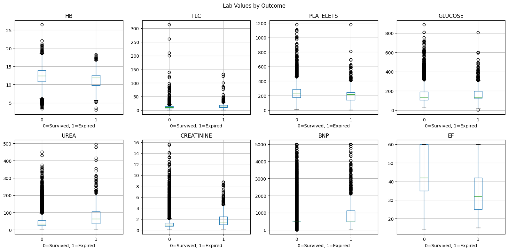

# Hospital Mortality Risk Prediction

**Healthcare Analytics | Python | Supervised Machine Learning**

## Research question
**Why it matters:** Hospitals must prioritize clinical monitoring and limited resources while avoiding excessive false alerts.

**Business question:** Can clinical measures and admission characteristics distinguish patients at higher risk of in-hospital mortality, and which model offers the most useful precision–recall trade-off?

## Data and methodology
The modeling dataset contains 15,757 observations (3,152 held out for testing). The binary outcome is survival versus death during hospitalization. Median imputation handles missing laboratory values; correlation analysis and chi-square tests inform selection of 13 predictors, including kidney and cardiac function markers, comorbidities and admission type. The notebook compares class-weighted logistic regression and random forest using a stratified 80/20 split and standardized features.

## Key findings

Higher urea and creatinine and lower ejection fraction distinguish the mortality group in exploratory analysis. Creatinine, ejection fraction, urea and total leukocyte count are the four highest-ranked random forest features.

| Test metric (mortality class) | Logistic regression | Random forest |
| --- | ---: | ---: |
| AUROC | 0.825 | 0.961 |
| Precision | 0.17 | 0.82 |
| Recall | 0.78 | 0.43 |
| F1 | 0.28 | 0.56 |

Logistic regression identified 173 of 221 deaths but generated 847 false positives; random forest identified 95 with 21 false positives.

## Business implications and limitations
The preferred operating point depends on the cost of missed cases and monitoring capacity. This retrospective analysis is not a clinical decision tool. Imputation and feature selection before splitting may bias evaluation; future work should fit these steps on training data only and verify patient independence, feature availability, calibration and external validity.

## Explore the analysis
[Project notebook](notebooks/hospital-mortality-risk.ipynb) · Python, pandas, scikit-learn, SciPy, Matplotlib, Seaborn.
